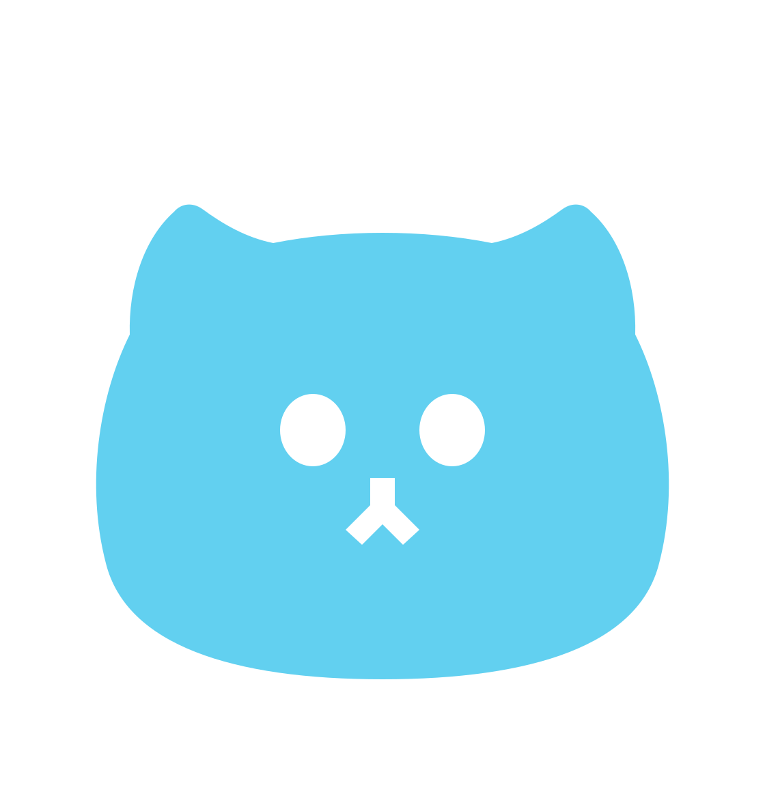
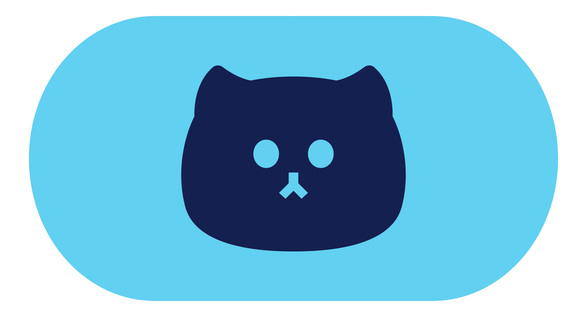

# Pyonpyon

A small symbol font for the terminal, starring Tippy. `Pyonpyon.otf` is built
from `glyphs/` by `build.py` and installed by this Order, to `~/Library/Fonts/`
on macOS and `~/.local/share/fonts/` on Linux.

## Glyphs

Code points are in Supplementary Private Use Area-B, clear of the Nerd Fonts
ranges. Once a glyph has been committed its code point never changes; new
glyphs are appended.

| Preview | Glyph | Code point | Width | Notes |
| --- | --- | --- | --- | --- |
|  | `tippy` | `U+100000` | square | Tippy. Shows about two cells wide when followed by a space (WezTerm lets square glyphs overflow into it). |
|  | `tippy-inverse-left` | `U+100001` | 1 cell | Left half of Tippy cut out of a solid block, eyes and mouth as ink. |
|  | `tippy-inverse-right` | `U+100002` | 1 cell | Right half, mirroring the left. |
|  | `pill-left` | `U+100003` | 1 cell | Rounded left end of the badge. |
|  | `pill-right` | `U+100004` | 1 cell | Rounded right end of the badge. |

The four one-cell glyphs form the prompt badge, all in one foreground color:



```text
pill-left  tippy-inverse-left  tippy-inverse-right  pill-right
U+100003   U+100001            U+100002             U+100004
```

They are sized to the terminal font's cell and fill its full height, so they
butt up without seams; a cell background on the two middle cells shows only
through Tippy's cut-out, giving Tippy a fill color. The sizes assume Fantasque
Sans Mono in every terminal (a cell 1060/2048 em wide, from its descent to its
ascent plus line gap). With another font they would show gaps: set `CELL`,
`BADGE_BOTTOM`/`BADGE_TOP`, and `PILL_END_WIDTH` in `build.py` from that font's
metrics and rebuild.

## Where it is used

- WezTerm (`orders/wezterm`) lists Pyonpyon as a fallback after Fantasque Sans
  Mono. Other terminals (kitty, alacritty, Konsole) find it through the system
  font fallback.
- The nushell prompt (`orders/nushell/nushell/env.nu`) shows the badge before
  the path.
- The location and command history pickers (`recall.nu` in the nushell
  modules) show `tippy` in their title badges.

Both appear everywhere except the Linux console (`TERM=linux`), which has no
font fallback; set `PYONPYON=1` or `PYONPYON=0` to override.

In nushell strings the glyphs are escapes such as `"\u{100000}"`.

## Building

```sh
uv run --script orders/pyonpyon/build.py
```

The script pins its `fontTools` version, writes `Pyonpyon.otf` and the SVGs in
`previews/`, and produces byte-identical output for unchanged sources. Commit
all three. Then deploy with `blend sync pyonpyon` and restart WezTerm, which
caches fonts; on Linux, run `fc-cache -f` if the font is not picked up.

To add a glyph, draw it as an SVG in `glyphs/` (1000x1000 viewBox, a single
path, holes drawn in the opposite direction) or in code in `build.py`, append
it to `GLYPHS` with the next code point, and add a row to the table above.
